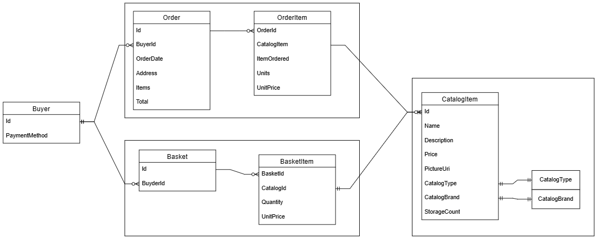

# Semesterprojekt2PBA

> Konvertering af Monolit til Microservices vha. Strangler Pattern

## 🔗 Links

| Ressource                     | Link                                                                                |
| ----------------------------- | ----------------------------------------------------------------------------------- |
| eShopOnWeb (original monolit) | [dotnet-architecture/eShopOnWeb](https://github.com/dotnet-architecture/eShopOnWeb) |
| Dokumentation                 | [Fællesdrev-SemesterProjekt2](https://drive.google.com/drive/folders/1r3rnDwQCycOy6qGiWcxL7VZdWAsgNBHc) |

---

# Opgavebeskrivelse: Konvertering af Monolit til Microservices vha Strangler Pattern

## Baggrund

I dette projekt skal I arbejde med omdannelsen af et stort, monolitisk system til en moderne microservice-arkitektur. I vil tage udgangspunkt i projektet eShopOnWeb, som er en monolitisk applikation, der simulerer en e-handelsplatform. Jeres opgave bliver gradvist at erstatte dele af systemet ved hjælp af et Strangler Pattern, hvilket betyder, at I flytter logikken ud i uafhængige microservices, samtidig med at det eksisterende system forbliver operationelt under overgangen.

## Hovedmål

Målet med projektet er at omdanne eShopOnWeb fra en monolit til en microservice-arkitektur, hvor hver service har klare ansvar, kan skaleres uafhængigt, og implementeres med passende kommunikationsmekanismer mellem tjenesterne. I skal derudover integrere et nyt lagerstyringssystem I har lavet, men ikke er implementeret i eShopOnWeb.

## Kravspecifikation

I skal sikre jer, at følgende krav opfyldes i jeres projekt:

1. **Identificér og afgræns services:** Analysér det eksisterende monolitiske system og identificér de forretningsdomæner, der kan adskilles som uafhængige microservices. I skal opdele monolitten i mindst 3 microservices, f.eks. til produktkatalog, ordrehåndtering og betalingsservice.
2. **Strangler Pattern implementering:** Brug strangler-patternet til gradvist at overføre funktionalitet fra det monolitiske system til de nye microservices uden at afbryde driften. De dele, der konverteres, skal rutes til microservices, mens de øvrige funktioner stadig kører i monolitten.
3. **Lagerstyringssystem:** Implementér det forberedte lagerstyringssystem i projektet. Systemet skal være ansvarligt for at holde styr på produktbeholdning, modtage opdateringer fra ordreafdelingen og f.eks håndtere reservation af produkter ved checkout. Dette skal implementeres som en selvstændig microservice.
4. **API Gateway:** Implementér en API Gateway, der fungerer som et samlet indgangspunkt for klientanmodninger og dirigerer dem til de rette microservices. Den skal også håndtere autentificering, load balancing og rate-limiting.
5. **Kommunikation mellem microservices:** Anvend asynkron beskedbaseret kommunikation (f.eks. med RabbitMQ, Azure Service Bus eller Kafka) mellem microservices til at sikre løs kobling og skalerbarhed, især når det gælder lagerstyring og ordrebehandling.
6. **Datahåndtering og dataseparation:** Hver microservice skal have sin egen database, og I skal sikre, at de services, der har brug for data fra andre services, får det via beskeder eller API-opkald.
7. **Fejlhåndtering og overvågning:** Implementér robuste mekanismer til fejlhåndtering og overvågning af microservices. Dette kan omfatte brug af Circuit Breaker mønstre, logging, samt centraliseret overvågning via f.eks. ELK stack (Elasticsearch, Logstash, Kibana) eller Prometheus/Grafana.
8. **CI/CD pipeline:** Opsæt en CI/CD pipeline, som understøtter automatisk bygning, test og deployment af microservices. Pipelinens opgaver inkluderer at køre automatiske tests, containerisering af services (f.eks. med Docker).
9. **Dokumentation:** Sørg for at dokumentere hele processen, både med hensyn til arkitekturbeslutninger, API'er, og microservices. Dette inkluderer også dokumentation af den nye lagerstyringsservice og hvordan denne interagerer med resten af systemet. Dette kan gøres I jeres README fil.

---

## 🏗️ Arkitektur



---

## ☁️ Azure (produktion)

Alle services er hostet i resource group `rg-eshop-pba2` (Sweden Central) under `Azure subscription 1`.

### App Services

| Service        | App Service       | URL                                                                                      |
| -------------- | ----------------- | ---------------------------------------------------------------------------------------- |
| Web (monolit)  | `app-eshop-web`   | https://app-eshop-web-esdbcdaaavgtbycw.swedencentral-01.azurewebsites.net                |
| OrderService   | `app-eshop-order` | https://app-eshop-order-dfd9awhue9hqacdu.swedencentral-01.azurewebsites.net             |
| CatalogService | `app-eshop-catalog` | https://app-eshop-catalog-cpfcatama7aqcpem.swedencentral-01.azurewebsites.net         |

### Databaser

Alle databaser kører på `sql-eshop-server.database.windows.net`:

| Database              | Tilhører          |
| --------------------- | ----------------- |
| `eshop-catalog`       | Web (monolit)     |
| `eshop-identity`      | Web (monolit)     |
| `eshop-order`         | OrderService      |
| `eshop-catalog-service` | CatalogService  |

### CI/CD

Hver service har sit eget workflow der deployer automatisk ved push til `main`:

| Workflow                             | Deployer til        |
| ------------------------------------ | ------------------- |
| `.github/workflows/dotnet.yml`       | `app-eshop-web`     |
| `.github/workflows/order.yml`        | `app-eshop-order`   |
| `.github/workflows/catalog.yml`      | `app-eshop-catalog` |

### Adgang til Azure-portalen

Kontakt Michael (mpeder75) for at få en invitation. Når du har accepteret:

1. Log ind på [portal.azure.com](https://portal.azure.com) med din **private** Microsoft-konto (ikke skolekontoen)
2. Klik på profil øverst til højre → **Switch directory** → vælg `Default Directory (mpeder75...)`

### Tilføj en ny service

1. Opret App Service i `rg-eshop-pba2` — brug eksisterende plan `ASP-rgeshoppba2-af44`
2. Opret database på `sql-eshop-server` (serverless, 1 GB)
3. Kør EF migrations lokalt med `--connection`-flag mod Azure SQL
4. Tilføj connection string under App Service → *Environment variables → Connection strings*
5. Download publish-profil og tilføj som GitHub secret (fx `AZURE_MYSERVICE_PUBLISH_PROFILE`)
6. Opret workflow-fil i `.github/workflows/` med path filter på `src/MyService/**`

---

## ⚙️ Opsætning (lokal udvikling)

> Udvides i takt med at vi implementerer flere teknologier (RabbitMQ, API Gateway, Docker osv.).

### Forudsætninger

| Værktøj | Krav | Note |
| ------- | ---- | ---- |
| **.NET 8 SDK** | Påkrævet — **SDK, ikke kun runtime** | `global.json` låser projektet til 8.0-serien (`rollForward: latestFeature`). En nyere SDK som .NET 10 bruges **ikke** til dette projekt, så har du kun .NET 10 installeret, fejler build. Hent SDK 8.0.x her: <https://dotnet.microsoft.com/download/dotnet/8.0> |
| **SQL Server LocalDB** | Påkrævet | Følger med Visual Studio. Verificer med `sqllocaldb info` → skal vise `MSSQLLocalDB`. |

Verificér at det rigtige SDK er på plads:

```bash
dotnet --list-sdks
# Der skal være en 8.0.x-linje (fx 8.0.425). 10.0.x må gerne stå ved siden af.
```

### 1. Klon repo

```bash
git clone https://github.com/mpeder75/Semesterprojekt2PBA.git
cd Semesterprojekt2PBA
```

### 2. Opret databaserne (EF Core migrations)

Projektet bruger som default en **rigtig** database (ikke in-memory). De medfølgende connection strings peger allerede på `(localdb)\MSSQLLocalDB`, så du skal normalt **ikke** ændre `appsettings.json`.

Kør migrations fra `src/Web`: **Så du skal fysisk stå i mappen og køre kommandoer**

```bash
Min ser således ud: 
PS C:\Users\mpede\source\repos\Semesterprojekt2PBA\src\Web>
```
### Kommandoer der skal køres lokalt for I kan genere databasen:
```bash
cd src/Web
dotnet restore
dotnet tool restore
dotnet ef database update -c catalogcontext -p ../Infrastructure/Infrastructure.csproj -s Web.csproj
dotnet ef database update -c appidentitydbcontext -p ../Infrastructure/Infrastructure.csproj -s Web.csproj
```

Det opretter to databaser på din LocalDB:

- `Microsoft.eShopOnWeb.CatalogDb` — katalog, kurv og ordrer
- `Microsoft.eShopOnWeb.Identity` — brugere og login

Du kan inspicere dem i SSMS ved at forbinde til serveren `(localdb)\MSSQLLocalDB`.

### 3. Kør applikationen

Vil du kun se selve butikken, er `Web`-projektet nok. Admin-siden (`/admin`) er en Blazor WebAssembly-app, der skal snakke med `PublicApi`, så den kræver at **begge** projekter kører:

```bash
# terminal 1 — fra src/PublicApi
dotnet run

# terminal 2 — fra src/Web
dotnet run --launch-profile Web
```

| Side | URL |
| ---- | --- |
| Butik | <https://localhost:5001/> |
| Admin | <https://localhost:5001/admin> |

Første kørsel **seeder** databaserne automatisk med produkter og testbrugere.

### Testbrugere

| Rolle | Email | Password |
| ----- | ----- | -------- |
| Almindelig bruger | `demouser@microsoft.com` | `Pass@word1` |
| Administrator (til `/admin`) | `admin@microsoft.com` | `Pass@word1` |

---

## .gitignore – Hvad er dækket?

| Kategori                    | Hvad ignoreres                                                                                                                                                        |
| --------------------------- | --------------------------------------------------------------------------------------------------------------------------------------------------------------------- |
| **.NET / C#**               | Build-output (`bin/`, `obj/`), NuGet-pakker, test-resultater, MSBuild-logs, `project.lock.json`                                                                       |
| **Visual Studio 2022/2026** | `.vs/`, publish-profiler med credentials (`*.pubxml`, `*.publishsettings`), cache-filer (`*.VC.db`, `*.[Cc]ache`), profiler-filer, temp-filer (`*.tmp`, `*.tmp_proj`) |
| **GitHub Copilot**          | Lokal Copilot-konfiguration (`.copilot/`)                                                                                                                             |
| **Claude Code**             | `.claude/`, `CLAUDE.md`, `.claudeignore`                                                                                                                              |
| **Secrets / miljø**         | `.env`-filer (undtagen `.env.example`), certifikater (`.pfx`, `.pem`, `.cer`), `appsettings.Development.json`, `secrets.json`                                         |
| **Docker**                  | Lokalt mountede volumes (`docker-data/`, `docker-volumes/`) — docker-compose filer commits til repo                                                                   |
| **RabbitMQ**                | Data- og logmapper, `mnesia/`, `.erlang.cookie`                                                                                                                       |
| **PostgreSQL**              | `pgdata/`, database dumps (`.dump`, `.pgdump`), `.pgpass`                                                                                                             |
| **Redis**                   | `dump.rdb`, `appendonly.aof`, logfiler                                                                                                                                |
| **SQL Server**              | `*.mdf`, `*.ldf`                                                                                                                                                      |
| **Frontend / Node**         | `node_modules/`, `.sass-cache/`, `wwwroot/lib/`                                                                                                                       |
| **OS**                      | `.DS_Store` (macOS), `Thumbs.db` (Windows), temp-filer                                                                                                                |
| **Diverse**                 | `*.dbmdl`, `ClientBin/`, `orleans.codegen.cs`                                                                                                                         |

> ⚠️ **Secrets må aldrig deles i git.** Brug `.env.example` som skabelon og udfyld din egen `.env` lokalt når det er opsat.
>
> 🐳 **Docker-compose filer committes** så alle kan køre samme miljø.
