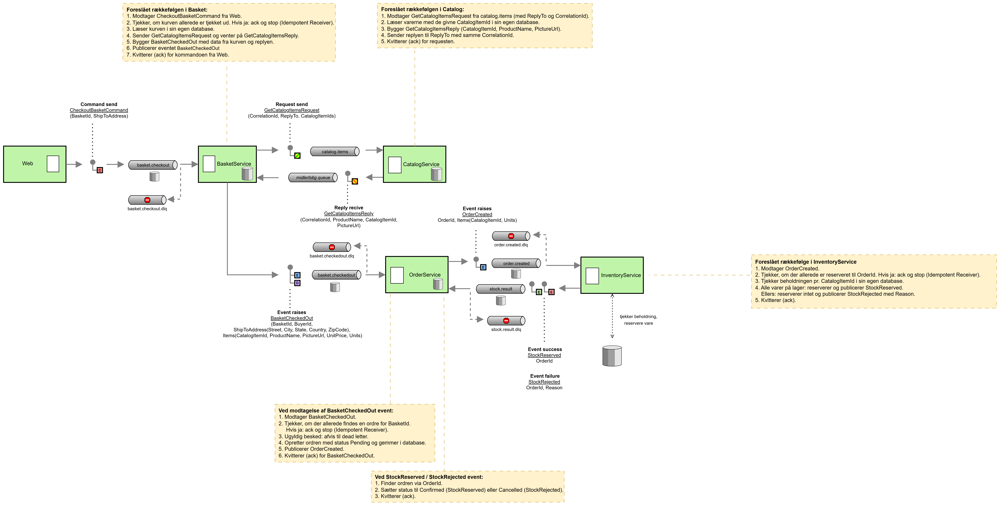

# Design: Create Order i microservice-arkitekturen

Forslag til det endelige flow for oprettelse af en ordre, med begrundelse, sammenligning
med en Process Manager-løsning og forberedelse til spørgsmål.

> **Status:** forslag, ikke besluttet i gruppen. Det er et *endeligt* design (som om alle
> services er stranglet), ikke et trin-for-trin-forløb. Se afsnit 8 for hvad der er
> bygget, og hvad der kun er designet.



---

## 1. Kort fortalt

1. Kunden trykker **Pay Now**. **Web** sender en *kommando* til **Basket**: "tjek denne kurv ud".
2. **Basket** samler køber, adresse og varelinjer, og spørger **Catalog** om navn og billede (request-reply).
3. **Basket** udsender eventet `BasketCheckedOut` med hele ordrens indhold.
4. **Order** lytter, gemmer ordren som *Pending* og udsender `OrderCreated`.
5. **Inventory** lytter, reserverer varerne og udsender `StockReserved` eller `StockRejected`.
6. **Order** lytter og sætter ordren til *Confirmed* eller *Cancelled*.

Ingen service kender hele forløbet. Hver service ved kun, hvad den lytter på, og hvad den
selv udsender. Det er pointen med designet.

---

## 2. Hvorfor ændrer vi det?

I eShopOnWeb er `CreateOrderAsync` én metode i monolitten, der gør alt: læser kurven,
slår produkter op, bygger ordren og gemmer den, i én database og én transaktion. Når
Basket, Catalog og Order bliver egne services med egne databaser (database-per-service),
findes det samme data i flere services. Spørgsmålet er så:

> **Hvem samler dataene, og hvem sørger for, at alle de berørte services får besked?**

Den oprindelige idé (og en kollegas forslag) var, at **Order** gør det: Order kalder Basket
og Catalog for at hente data, og fortæller bagefter Inventory om ordren. Det er en
*Process Manager* (se afsnit 5). Det virker, men gør Order til en dirigent, der kender og
er koblet til alle andre.

---

## 3. Det foreslåede design

### 3.1 Beskeder og kanaler

| # | Fra -> Til | Kanal | Besked | Indhold | EIP-mønster |
|---|---|---|---|---|---|
| 1 | Web -> Basket | `basket.checkout` | `CheckoutBasketCommand` | `BasketId`, `ShipToAddress` | Command Message, Point-to-Point Channel |
| 2a | Basket -> Catalog | `catalog.items` | `GetCatalogItemsRequest` | `CorrelationId`, `ReplyTo`, `CatalogItemIds` | Request-Reply, Return Address, Correlation Identifier |
| 2b | Catalog -> Basket | midlertidig reply-kø | `GetCatalogItemsReply` | `CorrelationId`, `Items`: `CatalogItemId`, `ProductName`, `PictureUrl` | Reply Message |
| 3 | Basket -> Order | `basket.checkedout` | `BasketCheckedOut` | `BasketId`, `BuyerId`, `ShipToAddress`, `Items`: `CatalogItemId`, `ProductName`, `PictureUrl`, `UnitPrice`, `Units` | Event Message + Document Message, Publish-Subscribe Channel |
| 4 | Order -> Inventory | `order.created` | `OrderCreated` | `OrderId`, `Items`: `CatalogItemId`, `Units` | Event/Document Message, Publish-Subscribe Channel |
| 5 | Inventory -> Order | `stock.result` | `StockReserved` {`OrderId`} / `StockRejected` {`OrderId`, `Reason`} | | Event Message, Publish-Subscribe Channel |

Trin 2a-2b er tilsammen et **Content Enricher**: Basket beriger sit eget data (id, pris,
antal) med Catalogs data (navn, billede), før den sender videre.

### 3.2 Hvad hver service gør

| Service | Ansvar i flowet |
|---|---|
| **Web** | Kun UI. Sender `CheckoutBasketCommand`. Ingen forretningslogik, ingen opslag. |
| **Basket** | Ejer kurven. Tjekker, om kurven allerede er tjekket ud, læser den, henter produktdata fra Catalog og udsender `BasketCheckedOut` (og først derefter ack af kommandoen). |
| **Catalog** | Svarer kun på request-reply om produktdata. Har ingen viden om ordrer. |
| **Order** | Lytter på `BasketCheckedOut`, gemmer ordren (*Pending*), udsender `OrderCreated`, og sætter status ud fra `StockReserved`/`StockRejected`. Slår intet op selv. |
| **Inventory** | Lytter på `OrderCreated`, tjekker og reserverer beholdning i sin egen database og udsender resultatet. |

### 3.3 Det samlede princip

> **Den service, der ejer et faktum, udsender eventet.**

- Basket ejer "kurven er tjekket ud", så Basket udsender `BasketCheckedOut`.
- Order ejer "ordren er oprettet", så Order udsender `OrderCreated`.
- Inventory ejer "varerne er reserveret/afvist", så Inventory udsender resultatet.
- Web ejer ingen forretningsdata. Web kan kun *bede om* noget (kommando), ikke melde, at noget *er sket*.

### 3.4 Tre slags beskeder

| Slags | Betyder | Går til | Bruges her til |
|---|---|---|---|
| **Kommando** | "Gør dette" (en hensigt) | Én modtager, der ejer opgaven | `CheckoutBasketCommand` |
| **Event** | "Dette er sket" (et faktum) | Alle der lytter | `BasketCheckedOut`, `OrderCreated`, `StockReserved`/`StockRejected` |
| **Request-reply** | "Giv mig data" | Én modtager, svaret går tilbage til afsenderen | Basket -> Catalog (og Web -> Order for "My orders") |

Request-reply bruges **kun til at læse**. Alt, der *ændrer noget*, sker med kommandoer og
events. Det er svaret på spørgsmålet "er det ikke bare request-reply hele vejen?".

---

## 4. EIP-mønstre brugt i designet

Alle navne er fra *Enterprise Integration Patterns* (Hohpe & Woolf).

| Mønster | Hvor | Hvorfor |
|---|---|---|
| **Message Channel** | Alle kanaler | Services kender kun kanalen, ikke hinanden |
| **Point-to-Point Channel** | `basket.checkout`, `catalog.items` | Præcis én modtager skal behandle beskeden |
| **Publish-Subscribe Channel** | `basket.checkedout`, `order.created`, `stock.result` | Flere kan lytte; afsenderen kender dem ikke |
| **Command Message** | `CheckoutBasketCommand` | En hensigt til en bestemt modtager |
| **Event Message** | `BasketCheckedOut`, `OrderCreated`, `Stock*` | Et faktum, der er sket |
| **Document Message** | `BasketCheckedOut`, `OrderCreated` | Beskeden bærer alle data, så modtageren ikke skal spørge tilbage |
| **Request-Reply** | Basket <-> Catalog | Hent data synkront i forhold til afsenderen |
| **Return Address** | `ReplyTo` | Besked om, hvor svaret skal hen |
| **Correlation Identifier** | `CorrelationId` | Parrer reply med den rigtige request |
| **Content Enricher** | Basket + Catalog | Tilføj manglende data, før beskeden sendes videre |
| **Guaranteed Delivery** | Database-ikon på kanalerne | Beskeder overlever en genstart |
| **Dead Letter Channel** | `*.dlq` | Hvor afviste/ubehandlelige beskeder ender |
| **Invalid Message Channel** | (samme `*.dlq`) | Ugyldige beskeder |
| **Idempotent Receiver** | Basket, Order, Inventory | Samme besked to gange giver samme resultat |
| **Event-Driven Consumer** | Alle consumers | Handler, når en besked ankommer (ingen polling) |

**I RabbitMQ:** Point-to-Point er standard-exchange og en navngivet kø. Publish-Subscribe er en
fanout- eller topic-exchange, hvor hver subscriber har sin *egen* kø. Dead-lettering er en
egenskab på køen (`x-dead-letter-exchange`).

**Bemærk:** "Saga" og "Transactional Outbox" findes **ikke** i EIP-bogen (de kommer fra
Garcia-Molina/microservices.io). Brug ordene *kompenserende handling* og *outbox*, hvis I
nævner dem, og sig, hvor de kommer fra.

---

## 5. Sammenligning med Process Manager (det oprindelige forslag)

### 5.1 Process Manager-modellen

Web kalder Order (via gatewayen). **Order** er Process Manager: den kalder Basket for at
hente kurven, kalder Catalog for produktdata, gemmer ordren og fortæller til sidst
Inventory (og evt. Basket) om ordren. Order kender hele forløbet og styrer det trin for trin.

```
Web --> Order --> Basket (hent kurv)
              --> Catalog (hent navn, billede)
              --> (gem ordre)
              --> Inventory (reserver)
```

### 5.2 Vores model (koreografi)

Hver service reagerer på events og udsender selv det næste. Ingen service har overblikket.

```
Web -cmd-> Basket -req/reply-> Catalog
Basket -event-> Order -event-> Inventory -event-> Order
```

### 5.3 Forskellene

| Emne | Process Manager (Order orkestrerer) | Vores (koreografi) |
|---|---|---|
| **Hvem kender forløbet?** | Order, alene | Ingen. Forløbet fremgår af, hvem der lytter på hvad |
| **Kobling** | Order er koblet til Basket, Catalog og Inventory | Hver service kender kun kanaler og beskeder |
| **Order-servicens ansvar** | Ordre + styring af andre services' data og kald | Kun ordrer |
| **Tilføj en ny deltager** (fx e-mail ved ordre) | Order skal ændres | Ny subscriber på `order.created`, ingen andre ændringer |
| **Ejerskab af data** | Order henter andres data selv | Basket ejer kurven, Catalog produkterne, Order ordren |
| **Hvis Order er nede** | Checkout kan slet ikke starte | Basket udsender stadig; eventet venter i køen |
| **Hvis Catalog er nede** | Order venter på både Basket og Catalog | Kun Basket venter på Catalog |
| **Enkelt fejlpunkt** | Order er i midten af alt | Ingen central |
| **Overblik og debugging** | Nemt: ét sted at kigge | Svært: man skal følge beskeder gennem flere services |
| **Konsistens** | Kan styres centralt, evt. i én transaktion | Eventual consistency; kompenserende handlinger |
| **Passer til krav 5** (løs kobling, især lager og ordre) | Delvist | Ja |

### 5.4 Fordele ved vores design

1. **Løsere kobling.** Order er kun koblet til *beskeder*, ikke til andre services. Det er
   præcis den løse kobling, kravspecifikationen (krav 5) beder om.
2. **Order beholder sit ene ansvar:** at eje ordrer.
3. **Nem at udvide.** En ny service, der skal reagere på en ordre, lytter blot på
   `order.created`. Ingen eksisterende service ændres.
4. **Ingen service er en flaskehals** eller et enkelt fejlpunkt i midten.
5. **Tolerant over for nedetid.** Events ligger i køen, til modtageren er tilbage.
6. **Hver service ejer sit eget data** (database-per-service, krav 6).
7. **Passer til lagerkravet** (krav 3): Inventory modtager ordreinformation som events og
   håndterer reservation som kompensation, hvis varen ikke findes.

### 5.5 Prisen (vær ærlig om den)

1. **Sværere at følge og debugge.** Forløbet står ikke ét sted. Det kræver et diagram,
   korrelations-id'er i beskeder og samlet logning.
2. **Eventual consistency.** Ordren er *Pending*, før Inventory har svaret. Kunden ser ikke
   en endelig status med det samme.
3. **Kompensation er ikke gratis.** `StockRejected` skal føre til *Cancelled*, og det skal
   designes og testes.
4. **Dual write.** Order gemmer og udsender bagefter. Går Order ned imellem, er ordren gemt,
   men eventet aldrig sendt. Løsning: *Transactional Outbox* (ikke bygget).
5. **Kræver idempotente modtagere,** fordi samme besked kan komme to gange.

### 5.6 Hvornår ville Process Manager være bedre?

- Når forløbet er langt og har mange betingelser og grene, hvor det er vigtigt at kunne
  se og ændre forløbet ét sted.
- Når man har brug for streng, central kontrol over rækkefølgen og et samlet overblik.
- Når antallet af services er lille, og teamet foretrækker enkelhed frem for løs kobling.

For *dette* flow (fire services, et lineært forløb og krav om løs kobling) er koreografi
et rimeligt valg. Pointen er, at I kan forklare, hvorfor, og hvad det koster.

### 5.7 Andre alternativer vi har vurderet

| Alternativ | For | Imod |
|---|---|---|
| A. Order orkestrerer (Process Manager) | Nemt at følge | Order koblet til alle; se ovenfor |
| B. Web samler data selv | Få ændringer i begyndelsen | Logik bliver i monolitten, som vi ellers fjerner |
| C. Web udsender et event om ordren | Simpelt for Web | Eventet beskriver noget, der ikke er sket; ingen ejer ordren; inkonsistens ved fejl |
| D. Basket gemmer navn/billede, når varen lægges i kurven | Ingen Catalog-opslag ved checkout | Duplikeret data, kan blive forældet |
| E. Alt som request-reply | Enklest | Tæt kobling; checkout fejler, hvis en service er nede |

---

## 6. Pålidelighed og fejlhåndtering

### 6.1 Hvor er Guaranteed Delivery og dead letter sat på

| Kanal | Guaranteed Delivery | Dead Letter | Bemærkning |
|---|---|---|---|
| `basket.checkout` | Ja | Ja | Tabes kommandoen, forsvinder kundens ordre |
| `catalog.items` | Nej | Nej | Læser kun; timeout + retry dækker det |
| reply-kø | Nej | Nej | Midlertidig, hører til afsenderens forbindelse |
| `basket.checkedout` | Ja | Ja | Tabes eventet, oprettes ordren aldrig |
| `order.created` | Ja | Ja | Tabes eventet, hører Inventory aldrig om ordren |
| `stock.result` | Ja | Ja | Tabes eventet, hænger ordren i *Pending* |

Guaranteed Delivery i RabbitMQ kræver **begge** dele: en *durable* kø **og** en *persistent*
besked (`DeliveryMode = Persistent`). En durable kø alene mister sine beskeder ved genstart.

### 6.2 Hvad sker der, hvis ...

| Hvis ... | Så ... |
|---|---|
| **Inventory er nede** | `OrderCreated` ligger i køen (durable). Ordren er *Pending*, til Inventory vender tilbage |
| **Inventory afviser** (`StockRejected`) | Order sætter ordren til *Cancelled* (kompenserende handling). Åbent: skal kurven genåbnes? |
| **Catalog er nede ved checkout** | Baskets request løber ud i en timeout (5 s). Kommandoen kvitteres ikke og prøves igen, eller checkout afvises med en fejl |
| **Order er nede** | `BasketCheckedOut` ligger i køen og behandles senere |
| **Brokeren er nede** | Al asynkron kommunikation stopper. Retry/Circuit Breaker, logning og overvågning (krav 7) |
| **Basket går ned midt i forløbet** | Kommandoen er ikke kvitteret (ack efter publicering), så den leveres igen. Derfor skal modtagere være idempotente |
| **Samme besked kommer to gange** | Idempotent Receiver: Order tjekker `BasketId`, Inventory tjekker `OrderId`, Basket tjekker om kurven allerede er tjekket ud |
| **Ugyldig besked** | Afvises til `*.dlq` i stedet for at forsvinde eller loope |
| **Order går ned efter gem, før `OrderCreated`** | Dual write (se 5.5). Outbox ville løse det. Kendt begrænsning |

### 6.3 Request-reply: hvorfor ikke persistent

En request er "giv mig data nu". Er den tabt, giver det en timeout, og afsenderen kan prøve
igen (en læse-request er sikker at gentage). Svarkøen er midlertidig og forsvinder med
forbindelsen, så en persistent request ville blive besvaret til en kø, der ikke findes mere.

---

## 7. Hvorfor får Order en kopi af data (snapshot)?

`BasketCheckedOut` bærer navn, billede og pris. Order gemmer dem i selve ordren. Det er
bevidst:
- En ordre skal ikke ændre sig, hvis Catalog senere ændrer en pris eller et navn.
- Order skal ikke kunne gå i stykker, hvis Catalog er nede.
- Det er **event-carried state transfer**: beskeden bærer det, modtageren skal bruge, så
  ingen skal spørge tilbage (det er det, et *Document Message* er).

Omvendt sender vi **kun kilde-data** og ingen afledte værdier. Totalpris er ikke med i
beskeden, fordi Order selv udregner den fra linjerne. Så kan data ikke modsige sig selv.

Hver service har **sine egne beskedklasser** (ikke et fælles projekt). Det er det modsatte af
EIP's *Canonical Data Model*. Fordelen er, at services kan bygges og deployes hver for sig.
Prisen er, at feltnavne skal matche manuelt (en stavefejl giver et tomt felt uden fejl),
så beskeder testes begge veje.

---

## 8. Hvad er bygget, og hvad er design?

**Vigtigt at kunne sige ærligt:**

| Del | Status |
|---|---|
| Order som egen service med egen database | Bygget og deployet i Azure |
| RabbitMQ lokalt (Docker) og hosted hos CloudAMQP til Azure | Bygget |
| Web sender kommando til Order (`order.create`), Order gemmer | Bygget (nuværende, midlertidig indgang) |
| "My orders" og Detail via request-reply (`order.list`, `order.get`) | Bygget og testet |
| `RequestReplyClient` (Correlation Id, midlertidig reply-kø, timeout) | Bygget |
| Basket-service med consumer på `basket.commands` | Bygget (kollega, merget) |
| `CheckoutBasketCommand`, Baskets checkout-handler | Kun design |
| Catalog som responder på `catalog.items` | Kun design |
| `BasketCheckedOut`, `OrderCreated`, `StockReserved`/`StockRejected` | Kun design |
| Inventory-service | Kun design |
| Ordrestatus (*Pending*/*Confirmed*/*Cancelled*) i Order | Kun design (viewet viser i dag hårdkodet "Pending") |
| Persistente beskeder | Ikke bygget (køerne er durable, beskederne er ikke persistente) |
| Dead-letter-køer | Ikke bygget (afviste beskeder forsvinder) |
| Idempotente modtagere | Ikke bygget |
| Transactional Outbox | Ikke planlagt |

Det nuværende flow (Web bygger `CreateOrderCommand` ud fra kurv og katalog i monolittens
database og sender den til `order.create`) er en **midlertidig mellemstation**. Læsesiden
(request-reply til Order) er uændret i det endelige design.

---

## 9. Mulige spørgsmål, og korte svar

### Design

1. **Hvorfor ikke bare HTTP mellem services?**
   HTTP ville være enklere til læsning. Vi valgte asynkron beskedkommunikation for løs
   kobling og for at tåle nedetid (krav 5). Prisen er mere kompleksitet.

2. **Er det ikke bare request-reply hele vejen?**
   Nej. Der er tre slags: kommando (Web -> Basket), events (resten af forløbet) og
   request-reply (kun til at læse: Basket -> Catalog og Web -> Order).

3. **Hvorfor sender Web en kommando til Basket og ikke til Order?**
   Basket ejer kurven og ved, hvad der skal købes. Order skal ikke jage data hos andre.

4. **Hvorfor udsender Basket eventet, og ikke Web?**
   Et event beskriver et faktum, og den service, der ejer det, udsender det. Web ejer
   ingen forretningsdata og kan kun bede om noget.

5. **Hvad er forskellen på en kommando og et event?**
   En kommando er en hensigt til én modtager ("gør dette"). Et event er et faktum til alle,
   der lytter ("dette er sket").

6. **Hvorfor bærer `BasketCheckedOut` alle data og ikke kun et id?**
   Så modtageren ikke skal spørge tilbage (Document Message). Det mindsker kobling.

7. **Hvorfor slår Order ikke selv navn og pris op i Catalog?**
   Ordren er et snapshot og skal ikke ændre sig, og Order skal ikke afhænge af Catalog.

8. **Hvorfor har hver service egne beskedklasser?**
   For at kunne bygge og deploye uafhængigt. Pris: feltnavne skal matche manuelt.

9. **Hvorfor Basket til at samle data og ikke Order (Process Manager)?**
   Se afsnit 5. Kort: løsere kobling, Order beholder ét ansvar, nem at udvide.

### Pålidelighed

10. **Hvad hvis Inventory er nede?** `OrderCreated` ligger i køen, ordren er *Pending*.
11. **Hvad hvis Catalog er nede?** Basket får timeout; kommandoen prøves igen eller afvises.
12. **Hvad hvis brokeren er nede?** Alt asynkront stopper; retry, Circuit Breaker, overvågning.
13. **Hvad hvis samme besked kommer to gange?** Idempotent Receiver (tjek på `BasketId`/`OrderId`).
14. **Hvad hvis Order går ned mellem gem og `OrderCreated`?** Dual write; Outbox ville løse det.
    Kendt begrænsning.
15. **Hvad sker der, når Inventory afviser?** `StockRejected` giver *Cancelled*
    (kompenserende handling).
16. **Hvad med rækkefølgen af beskeder?** Én kø bevarer rækkefølgen pr. kø, men ikke på tværs
    af køer. Designet er derfor ikke afhængigt af rækkefølge (id'er og idempotens).
17. **Forskellen på Dead Letter Channel og Invalid Message Channel?** Invalid: beskeden er
    ulæselig/ugyldig. Dead Letter: beskeden er gyldig, men kunne ikke leveres/behandles
    (afvist, for mange forsøg).

### Konsistens og drift

18. **Hvad ser kunden efter Pay Now?** En bekræftelse; ordren er *Pending*. Status kan ses
    under "My orders" (request-reply). Web venter ikke på resten af forløbet.
19. **Hvordan forklarer I eventual consistency?** Systemet er konsistent, når alle events er
    behandlet, ikke i samme øjeblik. Det er prisen for løs kobling.
20. **Hvordan følger man en ordre gennem systemet?** Via id'er (`BasketId`, `OrderId`,
    `CorrelationId`) i beskeder og samlet logning. EIP har *Wire Tap* og *Message Store*.
21. **Hvorfor RabbitMQ?** Modent, enkelt at komme i gang med, understøtter både kø (Point-to-Point)
    og exchange (Publish-Subscribe), og blev foreslået i kravspecifikationen.
22. **Kan man køre flere instanser af Order?** Ja. Flere consumers på samme kø er *Competing
    Consumers*; hver subscriber har sin egen kø.

### Ærlighed om status

23. **Er det her bygget?** Ikke alt. Se afsnit 8. Læsesiden og Order-servicen er bygget og
    deployet; checkout-flowet med Basket, Catalog og Inventory er design.
24. **Hvad er forskellen på det, der kører nu, og designet?** Nu bygger Web ordren selv og
    sender den til Order. I designet sender Web kun en kommando til Basket, og eventsene
    driver resten.

---

## 10. Andre relevante emner

- **At-least-once vs. exactly-once.** RabbitMQ leverer *mindst én gang*. Exactly-once findes
  ikke i praksis; man opnår samme effekt med idempotente modtagere.
- **Circuit Breaker og retry** på Baskets request til Catalog (krav 7).
- **Versionering af beskeder.** Tilføj nye felter i stedet for at ændre eller fjerne gamle,
  så gamle consumers ikke går i stykker.
- **Sikkerhed og identitet** er uden for scope (aftalt med underviseren); `BuyerId` sendes
  som almindeligt felt.
- **Gatewayen** (YARP) router kun HTTP udefra. Den sender ikke RabbitMQ-beskeder
  (Opsætning A, aftalt med underviseren).
- **Database-per-service:** Basket, Catalog, Order og Inventory har hver sin database
  (krav 6). Data deles via beskeder, ikke via fælles tabeller.
- **Lagerservice (krav 3)** er den eneste helt nye service. Den skal være simpel: tjek
  beholdning, reserver, udsend resultat.

---

## 11. Åbne punkter til gruppen

- Skal Basket tømme kurven ved `BasketCheckedOut`, eller først ved `StockReserved`?
  Og skal kurven genåbnes ved `StockRejected`?
- Order skal have et **statusfelt** (*Pending*/*Confirmed*/*Cancelled*); det findes ikke i
  dag.
- Baskets eksisterende consumer lytter på `basket.commands` med en envelope og dispatcher.
  Skal `CheckoutBasketCommand` være en ny handler dér i stedet for en ny kø
  `basket.checkout`? (Diagrammet viser `basket.checkout`.)
- Adressen kommer i dag hårdkodet i `Checkout.cshtml.cs`. Den skal komme fra formularen.
- Inventory: kontrakt (`OrderCreated`, `StockReserved`, `StockRejected`) og seed af
  beholdning.
- Persistente beskeder og dead-letter-køer skal bygges, hvis diagrammet skal passe til
  koden.
- Hvem bygger hvad (arbejdsdeling)?

---

## 12. Ordliste

| Begreb | Betydning |
|---|---|
| **Message Channel** | Rør mellem afsender og modtager |
| **Point-to-Point** | Én modtager behandler hver besked |
| **Publish-Subscribe** | Alle lyttere får en kopi |
| **Command / Event / Document** | Hensigt / faktum / besked, der bærer alle data |
| **Request-Reply** | Spørg og vent på svar via en svarkø |
| **Correlation Identifier** | Id, der parrer reply med request |
| **Return Address** | `ReplyTo`: hvor svaret skal hen |
| **Content Enricher** | Tilføjer manglende data til en besked |
| **Guaranteed Delivery** | Beskeder tabes ikke ved genstart (durable kø + persistent besked) |
| **Dead Letter Channel** | Kø til afviste/ubehandlelige beskeder |
| **Idempotent Receiver** | Samme besked to gange giver samme resultat |
| **Process Manager** | Central service, der styrer et forløb trin for trin (orkestrering) |
| **Koreografi** | Hver service reagerer på events, ingen styrer forløbet |
| **Eventual consistency** | Systemet bliver konsistent efter en tid, ikke øjeblikkeligt |
| **Outbox** | Gem event i samme transaktion som data, og send det derfra (microservices.io) |
